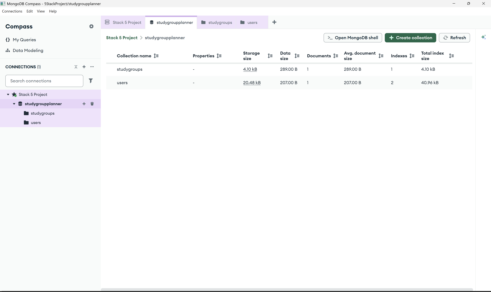
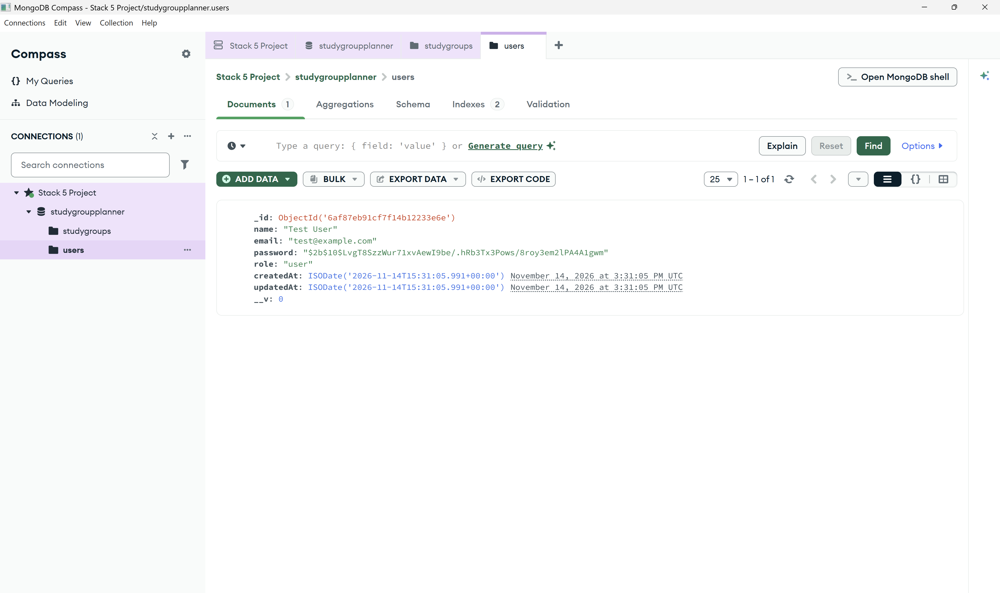
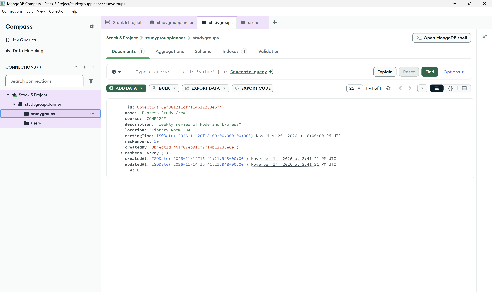
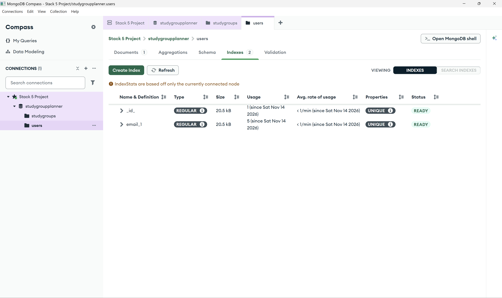

# Database Schema – Stack Five Study Group Planner

**Database:** MongoDB (local, `localhost:27017`), accessed through Mongoose  
**Database name:** `studygroupplanner`

| Collection | Purpose | Model file |
|---|---|---|
| `users` | Registered accounts and their roles | `server/models/User.js` |
| `studygroups` | Study groups, their owner and their members | `server/models/StudyGroup.js` |

Both schemas use `{ timestamps: true }`, so Mongoose adds `createdAt` and `updatedAt` to every document automatically. Each document also has the default `_id` (ObjectId).

---

## 1. User (`users`)

| Field | Type | Required | Constraints / Default | Description |
|---|---|---|---|---|
| `_id` | ObjectId | auto | Primary key | Unique user id |
| `name` | String | Yes | `trim` | Display name |
| `email` | String | Yes | `unique`, `lowercase` | Login identifier |
| `password` | String | Yes | `minlength: 6` | Stored as a bcrypt hash (10 salt rounds), never plain text |
| `role` | String | No | `enum: ['user', 'admin']`, default `'user'` | Used for authorization |
| `createdAt` | Date | auto | | Set by timestamps |
| `updatedAt` | Date | auto | | Set by timestamps |

**Behaviour**
- A `pre('save')` hook hashes the password with bcryptjs whenever the password is new or modified.
- `matchPassword(entered)` compares a plain-text password to the stored hash and is used at login.
- The auth middleware loads users with `.select('-password')`, so the hash is not exposed on `req.user`.

**Example document**
```json
{
  "_id": "665f1c2e8b1e4a0012a3b4c5",
  "name": "Jane Doe",
  "email": "jane@example.com",
  "password": "$2a$10$...hashed...",
  "role": "user",
  "createdAt": "2026-11-01T14:20:00.000Z",
  "updatedAt": "2026-11-01T14:20:00.000Z"
}
```

---

## 2. StudyGroup (`studygroups`)

| Field | Type | Required | Constraints / Default | Description |
|---|---|---|---|---|
| `_id` | ObjectId | auto | Primary key | Unique group id |
| `name` | String | Yes | `trim` | Group name |
| `course` | String | Yes | `trim` | Course code or name (e.g. COMP229) |
| `description` | String | No | default `''` | What the group studies |
| `location` | String | No | default `''` | Where the group meets |
| `meetingTime` | Date | No | | When the group meets |
| `maxMembers` | Number | No | default `10` | Member capacity |
| `createdBy` | ObjectId | Yes | `ref: 'User'` | Owner of the group |
| `members` | [ObjectId] | No | `ref: 'User'` | Users in the group; the creator is added on creation |
| `createdAt` | Date | auto | | Set by timestamps |
| `updatedAt` | Date | auto | | Set by timestamps |

**Behaviour**
- On creation, the controller sets `createdBy` to the logged-in user and adds that user to `members`.
- Only the creator or an `admin` can edit or delete a group.
- `getGroups` populates `createdBy` (name, email), and `getGroup` also populates `members` (name, email).

**Example document**
```json
{
  "_id": "665f1d9a8b1e4a0012a3b4d0",
  "name": "Express Study Crew",
  "course": "COMP229",
  "description": "Weekly review of Node and Express",
  "location": "Library Room 204",
  "meetingTime": "2026-11-20T18:00:00.000Z",
  "maxMembers": 10,
  "createdBy": "665f1c2e8b1e4a0012a3b4c5",
  "members": ["665f1c2e8b1e4a0012a3b4c5"],
  "createdAt": "2026-11-02T09:00:00.000Z",
  "updatedAt": "2026-11-02T09:00:00.000Z"
}
```

---

## 3. Relationships

```
User (1) ──────< StudyGroup      createdBy  (one user creates many groups)
User (M) >─────< StudyGroup      members    (many users belong to many groups)
```

- `StudyGroup.createdBy` references `User._id` (one-to-many).
- `StudyGroup.members[]` references `User._id` (many-to-many, stored on the group side).

---

## 4. Compass Screenshots

Screenshots of the live data in MongoDB Compass, connected to `localhost:27017`.

### 4.1 Database and collections

The `studygroupplanner` database contains the two collections, `users` and `studygroups`.



### 4.2 Users collection

A registered user. The `password` is stored as a bcrypt hash, and `role` defaults to `"user"`.



### 4.3 StudyGroups collection

A study group. `createdBy` stores the owner's user id, and `members` holds the ids of the users in the group.



### 4.4 Users indexes

The unique index on `email` prevents duplicate accounts, alongside the default `_id` index.

